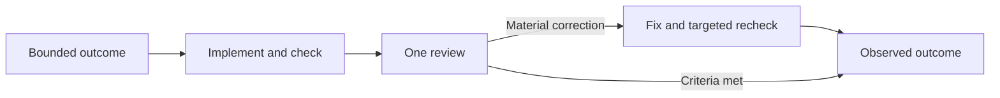

# Jerry SDLC

Jerry SDLC is a Codex and Claude Code plugin for proportionate software delivery. Describe the outcome; Jerry picks the smallest workflow that delivers it with credible evidence.

**Experimental.** It has not yet been shown to beat a plain agent on quality or cost. The bundled eval suite measures that; see [evaluation](docs/evaluation.md).

## Get started

### Codex

1. Register the marketplace:

   ```sh
   codex plugin marketplace add https://github.com/marwain91/jerry-sdlc.git
   ```

2. Install **Jerry SDLC** from the **Personal** marketplace using `/plugins`.
3. Start a new conversation in your project. Explicit skill selection is `$jsdlc-orchestrate`.

### Claude Code

```text
/plugin install jerry-sdlc --marketplace marwain91/jerry-sdlc
```

Or from a shell: `claude plugin marketplace add marwain91/jerry-sdlc`, then `claude plugin install jerry-sdlc@jerry-sdlc`. Explicit skill selection is `/jsdlc-orchestrate`.

### Upgrade

Neither tool refreshes its copy of the marketplace automatically. After a new version lands on `main`, refresh the marketplace, then update the plugin.

Codex:

```sh
codex plugin marketplace upgrade personal
codex plugin add jerry-sdlc@personal
```

Claude Code:

```sh
claude plugin marketplace update jerry-sdlc
claude plugin update jerry-sdlc@jerry-sdlc
```

Start a new conversation to load the new version. `codex plugin list` and `claude plugin list` show the installed version.

### Use it

```text
Use Jerry SDLC to fix this bug and verify the regression.
```

The plugin is instructions only: no hooks, no binaries, no project initialization, no generated repository files. Repository instructions and CI stay authoritative.

## What it does

| Request | Workflow |
|---|---|
| Typo or mechanical edit | Edit and one relevant check. |
| Bug fix | Red, then green; one bounded review for risky fixes. |
| Feature | One owner implements and checks; one bounded review. |
| Dependencies, CVEs, CI, infrastructure config | Before-and-after evidence, proven on the real target. |
| Release or deploy the user asked for | The project's own procedure, then the published or live result is verified. |
| Diagnosis or PR review | Read-only evidence or findings. |

One initial review and one targeted re-review per slice. A third round needs a named blocker. Specialists are added for a named risk only. Polish becomes follow-up work. Interface changes must be exercised for real.

- **Red, then green.** A bug fix starts with a test that fails for the reported reason, and the handoff shows that run and the passing run after the fix. When no test can express the failure, the agent reproduces it by hand and says so.
- **Cross-model review.** For features and risky fixes, the reviewer comes from the other model family when its CLI is installed and signed in: Claude Code asks Codex (`codex exec -s read-only`), and Codex asks Claude Code (`claude -p --permission-mode plan`). Otherwise a same-model reviewer is used, and the handoff says so.
- **Stop when blocked.** When the remaining work needs a person (access, hardware, approval), the agent lists each blocker once and stops instead of re-auditing.
- **Project procedures win.** A project's own release, deploy, or content skill runs the show; Jerry adds only the evidence bar.



## Layout

```text
plugins/jerry-sdlc/
  .codex-plugin/plugin.json          Codex plugin manifest
  .claude-plugin/plugin.json         Claude Code plugin manifest
  skills/jsdlc-orchestrate/
    SKILL.md                         routing, workflows, and core rules
    references/ux.md                 product design and UX checks
    references/handoffs.md           what to send delegated reviewers
  evals/                             claude plugin eval suite
.agents/plugins/marketplace.json     Codex marketplace catalog
.claude-plugin/marketplace.json      Claude Code marketplace catalog
scripts/check.sh                     structural checks run by CI
docs/evaluation.md                   how to test whether Jerry helps
```

Versions up to 0.1.x also shipped a Go CLI for evidence records, formal release verdicts, and cost ledgers; it was removed in 0.2.0. Versions 0.3.x shipped a test-guard `Stop` hook; it was removed in 0.4.0 after it raised 26 warnings in real use and none was a weakened test (see [evaluation](docs/evaluation.md)). Git history has both.

| Guide | Contents |
|---|---|
| [Evaluation](docs/evaluation.md) | Baseline-versus-Jerry comparison protocol |
| [Contributing](CONTRIBUTING.md) | Editing the instructions |
| [Security](SECURITY.md) | Trust boundaries and reporting |

Licensed under Apache License 2.0.
