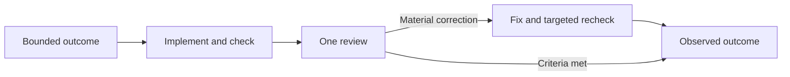

# Jerry SDLC

Jerry SDLC is a Codex plugin for proportionate software delivery. Describe the outcome; Jerry selects a bounded workflow with useful checks and review.

**Experimental:** quality and cost improvement have not been established. Formal release readiness has unmet assurance requirements and must not be used as production release authority. See [status](docs/status.md) and [security](SECURITY.md).

## Get started

Use a Codex version with plugin support. Linux x86-64 has experimental execution evidence; native macOS validation is pending.

1. Register the marketplace:

   ```sh
   codex plugin marketplace add https://github.com/marwain91/jerry-sdlc.git
   ```

2. Install **Jerry SDLC** from the **Personal** marketplace using `/plugins`.
3. Start a new conversation in your project:

   ```text
   Use Jerry SDLC to fix this bug and verify the regression.
   ```

Explicit skill selection is `$jsdlc-orchestrate`. The plugin bundles its CLI; Go is needed only for development. No project initialization or generated project files are required. Repository instructions and canonical CI remain authoritative. See the official [plugin setup guide](https://developers.openai.com/plugins/build/plugins#add-a-marketplace-from-the-cli).

## Lightweight by default

| Request | Default workflow |
|---|---|
| Feature or bug fix | One owner plans/diagnoses, implements, and runs meaningful checks; one bounded reviewer. |
| Typo or mechanical edit | One owner and a relevant check; no delegation. |
| Diagnosis or PR review | Read-only evidence/findings within the requested scope. |
| Incident | Applicable diagnosis and authorized mitigation, with observed recovery checks. |
| Explicit release-readiness assessment | Separate formal contract and full assurance requirements. |

One initial review and one targeted correction review are the default per slice. Further rounds need a named material blocker. Extra specialists address a specific risk or missing coverage. The owner can cover planning and QA; one reviewer can cover code and focused UX. New user journeys still need a brief and actual interaction checks. Optional polish becomes follow-up work.



Read [everyday delivery](plugins/jerry-sdlc/skills/jsdlc-orchestrate/references/delivery-workflows.md), [experience guidance](plugins/jerry-sdlc/skills/jsdlc-orchestrate/references/product-design-ux.md), and [cost controls](plugins/jerry-sdlc/skills/jsdlc-orchestrate/references/efficiency.md) when applicable. Ordinary work does not require doctor, formal verdicts, or JSON role reports.

## Optional CLI evidence and cost tools

- `roles --workflow feature` returns lightweight roles; `--profile full` retains the larger contract.
- `delivery-start` defaults to lightweight. Optional declared candidate scope and dependency-bound check reuse avoid invalidating unrelated work. Fresh candidates still need fresh reviewer conclusions.
- `preflight` probes a shared prerequisite once. `wait-check` polls an exact existing job within a bounded timeout.
- `slice-start/record/status` records private review rounds, active/wait time, worker-inclusive cached/uncached/output tokens, adjudicated findings, escaped defects, and reopened work.
- `eval-comparison` compares baseline, lightweight, and full on supplied matched results. Its exploratory limits default to 1.5× baseline active time and uncached-input-plus-output tokens. It does not execute model trials or establish graduation.

CLI examples use the bundled `plugins/jerry-sdlc/scripts/jsdlc` prefix and the project's permitted execution environment. See [recorded delivery](plugins/jerry-sdlc/skills/jsdlc-orchestrate/references/recorded-delivery.md). A ledger enforces recorded review admission only; without a runtime adapter it cannot guarantee a model token cap. Unknown measurements remain unknown.

## Understand results

Ordinary handoffs report observed engineering outcomes and unmet criteria. Optional records return COMPLETE, ISSUES, INCOMPLETE, or BLOCKED for their exact candidate and declared scope. Scope/runtime/dependency completeness is caller-declared; records are LOCAL_UNATTESTED. Older records without a profile retain full semantics.

Everyday results have no release-readiness effect. Local workers do not establish trusted independence. No result authorizes publication, tagging, deployment, release, spending, or secret access. Incident repository evidence does not prove production recovery.

## Documentation

| Guide | Contents |
|---|---|
| [Architecture](docs/architecture.md) | Contracts, profiles, state, and evidence |
| [Status](docs/status.md) | Implemented capabilities and missing evidence |
| [Compatibility](docs/compatibility.md) | Platforms, adapters, and coexistence |
| [Evaluation](docs/evaluation.md) | Exploratory comparison and preserved graduation requirements |
| [Contributing](CONTRIBUTING.md) | Container-based development and reproducible packaging |
| [Security](SECURITY.md) | Trust boundaries |

Licensed under Apache License 2.0.
